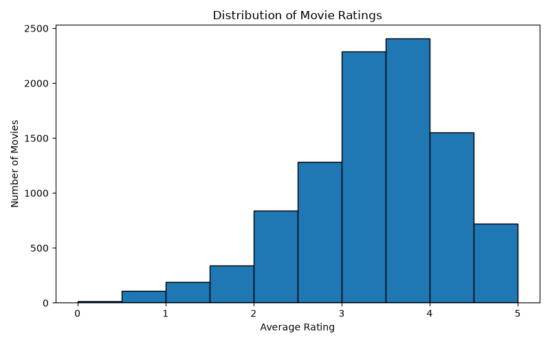
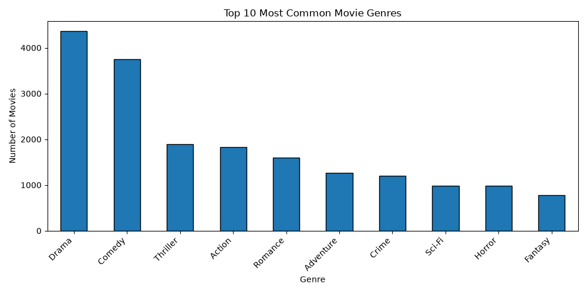
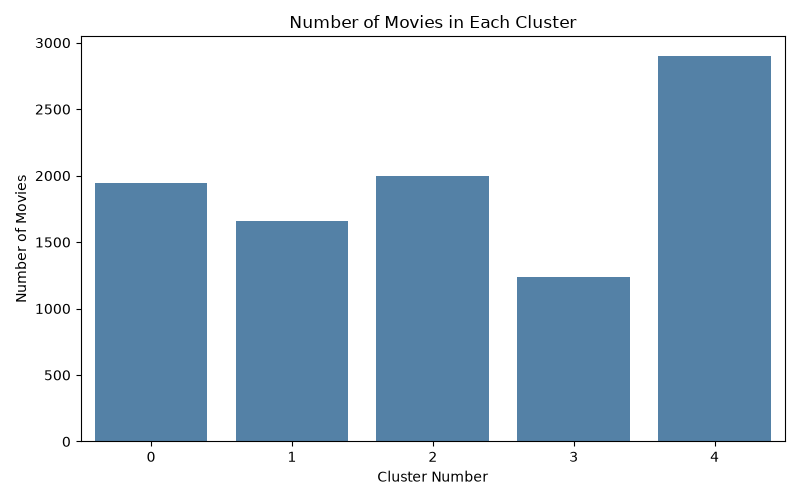

# Movie Recommendation System

A Python-based movie recommendation system that uses **K-Means clustering** and MovieLens data to group similar movies and recommend highly rated movies from the same cluster.

## Features

- Analyzes movie ratings.
- Groups movies using K-Means clustering.
- Recommends movies based on cluster membership, average rating, and rating count.
- Visualizes rating distribution, genre distribution, and movie clusters.
- Exports clustered movie data to a CSV file.

## Technologies Used

- Python
- Pandas
- NumPy
- Matplotlib
- Seaborn
- Scikit-learn

## Project Structure

```text
movie-recommendation-system/
├── data/
│   ├── movies.csv
│   └── ratings.csv
├── main.py
├── requirements.txt
├── rating_distribution.png
├── genre_distribution.png
├── cluster_visualization.png
├── movie_clusters.csv
└── README.md
```

## Setup and Installation

1. Clone this repository.
2. Open the project folder in your terminal.
3. Create and activate a Python virtual environment if desired.
4. Install the required libraries:

```bash
pip install -r requirements.txt
```

## Dataset

This project requires `movies.csv` and `ratings.csv` inside the `data/` folder. These files are excluded from Git, so obtain the corresponding MovieLens dataset and place the required CSV files in that folder before running the project. Make sure the dataset version and filenames match the code.

## Run the Project

```bash
python main.py
```

The program generates movie recommendations and saves visualization images and clustered movie data in the project folder.

## Visualizations

### Rating Distribution


### Genre Distribution


### Movie Clusters
